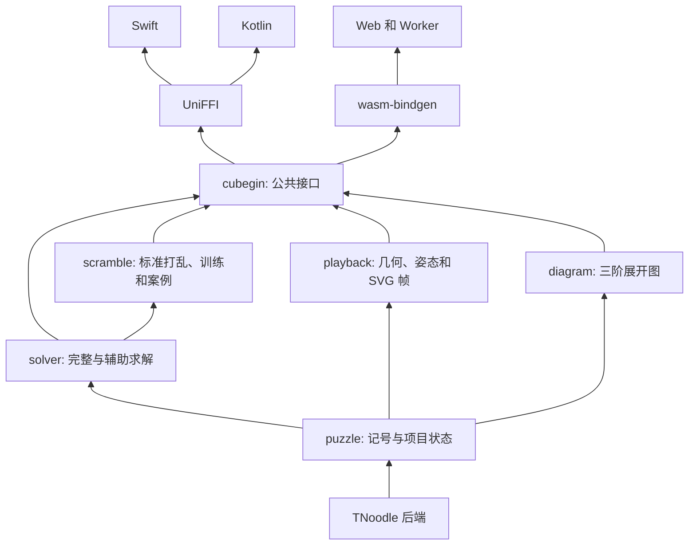

# 架构

`cubegin` 包含 Rust 引擎、平台 SDK 和 App。Rust 和 npm 包名为 `cubegin`，Swift 使用
`Cubegin` 和 `CubeginFFI`，Android 使用 `io.github.deweyou:cubegin`，命名空间为
`io.github.deweyou.cubegin`。

TNoodle 后端是工作区内有独立归属的 crate。领域 crate 实现魔方语义，绑定负责传递公共记录和带版本的 JSON。iOS App 位于 `apps/ios/`，通过根 Swift Package 链接本地 XCFramework，负责 UI、存储、手势和计时。Android SDK 位于 `sdk/android/`，未来的 Android App 放在 `apps/android/`。

原三阶外层转动 API 继续可用。项目 API 覆盖 18 个旧版标准项目 ID、各魔方记号、宽层、中层和整转。状态记录保留旧版布局，FTO 用共轭样例验证约定。不支持的语法返回错误。五至七阶和 Megaminx 无完整求解。

完整求解器将解法在项目状态上回放，独立的三阶几何引擎验证拼块合法性。训练采用受约束的状态构造、均匀或自然权重的案例选择、有限子群采样和回放。批量生成通过有限重试避免重复的归一化状态，无解请求返回错误。

固定后端和版本时，种子生成具有确定性。u32 种子用于诊断和复现。求解表冷启动开销可能较大，接口同步执行，App 应在后台调度。Web Worker 客户端销毁时会终止待处理任务。

回放提供不可变拼块几何、实体跟踪、转轴、四元数、时长和确定性的任意定位。Square-1 支持楔块交换，Clock 跟踪指针、按钮和面板方向。Rust 无需 DOM 即可渲染 SVG。原生 App 可以使用 SVG 帧，或用自己的 GPU 渲染器绘制 JSON 几何。输出为 `schemaVersion: 1`。

`examples/` 存放诊断消费方。`xtask` 调用 Cargo、Node、SwiftPM 和 Gradle 构建本地产物。
