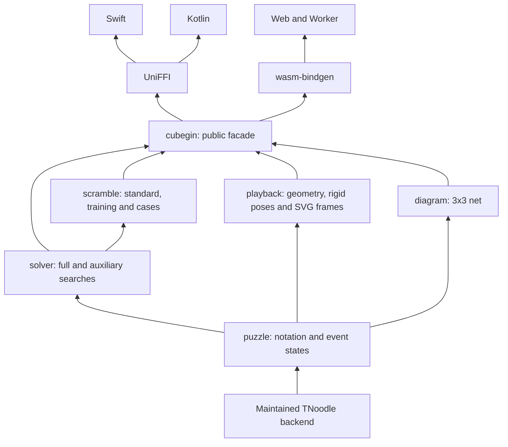

# Architecture

The backend is a separately attributed workspace crate. Domain crates own semantics;
bindings marshal public records and versioned JSON without reimplementing moves.
Products, persistence, gestures and timers belong in other repositories.

The original 3x3 outer-turn API stays available. The event API handles 18 legacy
standard IDs, puzzle-specific notation, wide/slice turns and rotations. Event state
records preserve legacy image layouts, with conjugacy fixtures for FTO conventions.
Unsupported syntax returns an error. The facade does not claim a full solver for
5x5–7x7 or Megaminx, matching the legacy capability boundary.

Full solvers replay solutions against event state. The independent 3x3 geometric
engine checks cubie legality. Training uses constrained state construction, case
selection (uniform/natural), bounded subgroup sampling and replay. Batches avoid
repeated normalized states with bounded retry; an impossible request fails.

Seeded generation is deterministic for the pinned backend and release. A u32 seed
is a diagnostic/reproducibility interface, not a competition entropy guarantee.
Cold solver tables can be substantial. Calls are synchronous and have no deadline
or cancellation guarantee; products schedule native work off the main thread. Web
includes a dedicated Worker client whose disposal terminates pending work.

Playback exposes immutable piece geometry, physical-piece tracking, rotation axes,
quaternions, duration and deterministic arbitrary seek. Square-1 owns wedge exchange;
Clock owns physical hands/pins and board orientation. SVG frame rendering is Rust
and DOM-free. Native products may render SVG frames or the same JSON geometry with
their own GPU renderer. Platform view widgets and application controls are not part
of the shared engine. Output carries `schemaVersion: 1`.

`examples/` contains diagnostic consumers. `xtask` invokes Cargo/Node/SwiftPM/Gradle;
it introduces no repository workflow service. Builds do not publish anything.
